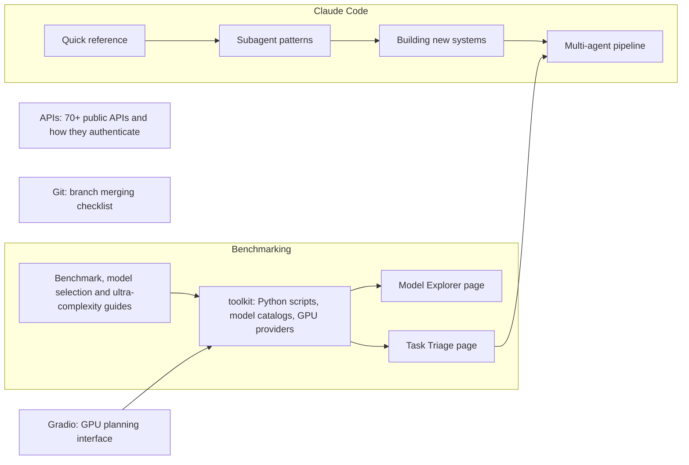

# Development tools

Guides and tools for building with AI: calling APIs, picking and benchmarking models on rented GPUs, orchestrating Claude Code agents, and merging git branches. Most of it was written in a handful of chats in November 2025.

## Benchmarking

Choose a model and a GPU, and work out what a task needs.

| Start with | What it is |
|---|---|
| [Model Explorer](benchmarking/model-explorer/index.html) | Browse and filter the model catalogue by GPU, size and cost (runs in the browser) |
| [Task Triage](benchmarking/task-assessor/index.html) | Answer questions about a task and get its complexity level and the model it needs |
| [Benchmark guide](benchmarking/BENCHMARK_GUIDE.md) | How to measure Modal GPUs against published numbers |
| [Model selection guide](benchmarking/MODEL_SELECTION_GUIDE.md) | Which models fit which GPU |
| [Missing models addendum](benchmarking/MISSING_MODELS_ADDENDUM.md) | Chinese models and Qwen-Coder variants |
| [Beyond 32B](benchmarking/ULTRA_COMPLEXITY_LEVEL_6_PLUS.md) | Levels 6 to 8, where one model is not enough |

The code behind all of this is in [`benchmarking/toolkit`](benchmarking/toolkit/README.md). It used to sit in `learning-resources/chess/` by mistake, left over from the first merge, and was moved here with its guides.

## Claude Code

Five overlapping guides on orchestrating agents. Read them in this order:

1. [Orchestration quick reference](claude-code/ORCHESTRATION_QUICK_REF.md): one page, when multi-agent is worth it
2. [Subagent patterns](claude-code/CLAUDE_CODE_SUBAGENT_PATTERNS.md): templates for the Task tool
3. [Greenfield quick start](claude-code/GREENFIELD_QUICK_START.md): decision tree for a new system
4. [Building new systems](claude-code/BUILDING_NEW_SYSTEMS_GUIDE.md): the long version of 3
5. [Multi-agent pipeline guide](claude-code/MULTI_AGENT_PIPELINE_GUIDE.md): Level 6+ tasks across several models

Items 1 and 2 are short references. Items 4 and 5 are each over 1,300 lines, and 4 repeats much of 3.

## APIs

| Document | Covers |
|---|---|
| [Popular API examples](apis/popular-api-call-examples.md) | 20 popular public APIs |
| [Information API examples](apis/information-api-call-examples.md) | 50 data-only APIs |
| [Additional app APIs](apis/additional-popular-app-apis.md) | 44 more |
| [Authentication analysis](apis/api-authentication-analysis.md) | Which of the first 70 need a key (the 44 additional ones state it per API) |

The examples are plain-language search phrases, not working requests. Each API heading is followed by a link to the provider's official documentation. Those links were added in a later pass from memory and have not been re-checked, so a few may have moved; where no page was found the link points to the [public-apis directory](https://github.com/public-apis/public-apis).

## Gradio and Git

- [GPU planning interface](gradio/GPU_PLANNING_INTERFACE.md): a Gradio app that falls back between Modal and Blaxel. Its code is in the [toolkit](benchmarking/toolkit/README.md).
- [Branch merging checklist](git/branch-merging-checklist.md): general checklist. For this repository's own merge, see the [merge guide](../MERGE_COMPLETE.md).
